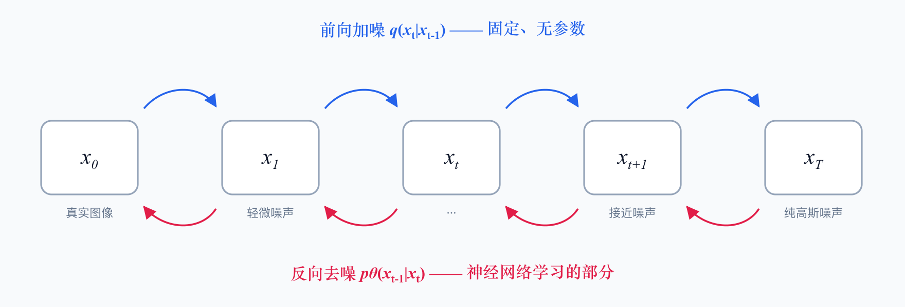

import Note from '/src/components/Note.astro';
import Figure from '/src/components/Figure.astro';
import Algorithm from '/src/components/Algorithm.astro';

## 1. 什么是 Diffusion Model

用于生成图像的扩散模型（Diffusion Model）是一种基于概率的生成模型，它通过逐步添加噪声到数据中，然后学习如何逆转这个过程，从而生成新的数据样本。扩散模型在图像生成、语音合成等领域表现出色，尤其是在高质量图像生成方面。

它的核心想法可以用一句话概括：**把"生成"这个困难问题，拆成 $T$ 个"去掉一点点噪声"的简单问题**。

单步从纯噪声直接跳到一张清晰图像，是一个极难拟合的映射。但如果每一步只要求网络把信噪比提高一点点，每一步就都变成了一个温和的回归问题。代价是采样时要跑 $T$ 次网络前向。

<Figure caption="扩散模型的两条链路：前向固定加噪，反向学习去噪。" source="示意图，依 DDPM (Ho et al., 2020) 的定义重绘">

</Figure>

两条链路的性质完全不同，这是理解扩散模型最关键的一点：

- **前向过程 $q$**：人为定义的、固定的、**没有任何可学习参数**。它只是按预设的方差表往图像上撒高斯噪声。
- **反向过程 $p_\theta$**：**唯一需要训练的部分**。网络要学会在每个噪声水平上把噪声估计出来。

## 2. 核心模块

### 2.1 前向过程：加噪

前向过程是一条马尔可夫链，每一步按方差表 $\{\beta_t\}_{t=1}^{T}$（通常从 $10^{-4}$ 线性增长到 $0.02$）加噪：

$$
q(x_t \mid x_{t-1}) = \mathcal{N}\!\left(x_t;\ \sqrt{1-\beta_t}\,x_{t-1},\ \beta_t \mathbf{I}\right)
$$

如果老老实实迭代 $T$ 次才能得到 $x_t$，训练会慢得没法用。好在高斯分布的叠加性给了一个闭式解。令 $\alpha_t = 1 - \beta_t$、$\bar\alpha_t = \prod_{s=1}^{t}\alpha_s$，则可以**一步到位**采样任意时刻的 $x_t$：

$$
x_t = \sqrt{\bar\alpha_t}\,x_0 + \sqrt{1-\bar\alpha_t}\,\epsilon,
\qquad \epsilon \sim \mathcal{N}(0, \mathbf{I})
$$

<Note type="hint" title="为什么这个闭式解重要">
它让训练可以随机采一个 $t$ 就直接构造出 $(x_t, \epsilon)$ 训练对，不必模拟整条链。没有这一条，扩散模型在工程上是不可行的。
</Note>

$\bar\alpha_t$ 从 1 单调递减到接近 0，正好刻画了"信号占比"：$t$ 小时 $x_t$ 几乎是原图，$t \to T$ 时 $x_T$ 收敛到各向同性的标准高斯噪声——这也是采样时可以从纯噪声起步的原因。

### 2.2 Denoise Module

反向过程要建模 $p_\theta(x_{t-1} \mid x_t)$。理论上应该让网络预测这个分布的均值，但 DDPM 的关键简化是：**改成让网络预测当初加进去的那个噪声 $\epsilon$**。

网络 $\epsilon_\theta(x_t, t)$ 的输入是含噪图像和时间步，输出是与图像同形状的噪声估计。注意 $t$ 必须作为输入喂进去——同一个网络要处理从"几乎无噪"到"纯噪声"的所有噪声水平，不告诉它当前处在哪一步，它无法判断该去掉多少。实现上 $t$ 通常经正弦位置编码后注入 U-Net 的各个残差块。

于是训练目标塌缩成一个极简的 MSE：

$$
L_{\text{simple}} = \mathbb{E}_{t,\,x_0,\,\epsilon}
\left[\left\| \epsilon - \epsilon_\theta\!\left(\sqrt{\bar\alpha_t}x_0 + \sqrt{1-\bar\alpha_t}\epsilon,\ t\right) \right\|^2\right]
$$

这个式子是从变分下界（ELBO）推导后**丢掉权重项**得到的。理论上带权重才是严格的 ELBO，但实践中发现去掉权重反而效果更好——相当于让模型在高噪声段投入更多容量。

<Algorithm
  code={String.raw`
\begin{algorithm}
\caption{DDPM 训练}
\begin{algorithmic}
\REQUIRE 数据分布 $q(x_0)$，方差表 $\{\beta_t\}_{t=1}^{T}$
\REPEAT
    \STATE $x_0 \sim q(x_0)$ \COMMENT{取一张真实图像}
    \STATE $t \sim \mathrm{Uniform}(\{1, \dots, T\})$ \COMMENT{随机噪声水平}
    \STATE $\epsilon \sim \mathcal{N}(0, \mathbf{I})$
    \STATE $x_t = \sqrt{\bar\alpha_t}\,x_0 + \sqrt{1-\bar\alpha_t}\,\epsilon$ \COMMENT{闭式解，无需迭代}
    \STATE 对 $\nabla_\theta \left\| \epsilon - \epsilon_\theta(x_t, t) \right\|^2$ 做一步梯度下降
\UNTIL{收敛}
\end{algorithmic}
\end{algorithm}
`}
/>

采样则是把这条链倒着走一遍。每一步先用网络估出噪声、减掉，再**重新注入**一点方差为 $\sigma_t^2$ 的噪声：

<Algorithm
  code={String.raw`
\begin{algorithm}
\caption{DDPM 采样}
\begin{algorithmic}
\REQUIRE 训练好的 $\epsilon_\theta$，方差表 $\{\beta_t\}_{t=1}^{T}$
\STATE $x_T \sim \mathcal{N}(0, \mathbf{I})$ \COMMENT{从纯高斯噪声起步}
\FOR{$t = T$ \TO $1$}
    \IF{$t > 1$}
        \STATE $z \sim \mathcal{N}(0, \mathbf{I})$
    \ELSE
        \STATE $z = 0$ \COMMENT{最后一步不再加噪}
    \ENDIF
    \STATE $x_{t-1} = \dfrac{1}{\sqrt{\alpha_t}}\left(x_t - \dfrac{1-\alpha_t}{\sqrt{1-\bar\alpha_t}}\,\epsilon_\theta(x_t, t)\right) + \sigma_t z$
\ENDFOR
\RETURN $x_0$
\end{algorithmic}
\end{algorithm}
`}
/>

<Note type="warning" title="为什么减完噪声还要再加回去">
如果去掉 $\sigma_t z$ 这一项，采样就退化成确定性的梯度上升，结果会收敛到分布的高密度区——生成的图像模糊、多样性塌缩。重新注入的噪声是在**采样一个分布**，而不是在求它的众数。
</Note>

## 3. Stable Diffusion / DALL·E

核心是三个分开训练的模块：**Text Encoder, Generation Model, Decoder**

这三个模块通常**各自独立训练**，而不是端到端联调。这是工程上很重要的一点：Text Encoder 可以直接复用现成的预训练模型，Decoder 可以在纯图像数据上训练，只有中间的 Generation Model 需要图文配对数据。

### 3.1 Text Encoder

Text Encoder 将文本输入编码为潜在空间的表示，通常使用 Transformer 架构 (GPT, BERT, CLIP 等) 来捕捉文本的语义信息。编码后的表示将作为生成模型的条件输入。

<Note type="info">
FID (Fréchet Inception Distance) 是衡量生成图像质量的指标，数值越低表示生成图像与真实图像的分布越接近。
CLIP (Contrastive Language-Image Pretraining) 是一种用于图像和文本的对比学习方法，它可以将图像和文本映射到同一个潜在空间，从而实现跨模态的理解和生成。
</Note>

一个反直觉但被反复验证的结论是：**放大 Text Encoder 带来的收益，明显大于放大扩散模型本身**。Imagen 的消融实验显示，把 U-Net 参数翻倍对 FID 的改善有限，而换用更大的 T5 文本编码器则同时改善了 FID 和图文对齐度。原因不难理解——如果文本表示里根本没编码进"红色的""在左边"这类信息，后面的扩散模型再大也无从还原。

### 3.2 Generation Model

这一层就是第 2 节的扩散模型，但有两处关键改动。

**第一，在 latent space 上做扩散。** 直接在 512×512×3 的像素空间跑 $T$ 步去噪，计算量难以接受。Latent Diffusion（也就是 Stable Diffusion 的 LDM）的做法是先用一个预训练的 VAE 把图像压到 64×64×4 的潜表示，扩散全程都在这个空间进行，**空间维度降到 1/64**。第 2 节所有公式原样成立，只是把 $x_t$ 换成潜变量 $z_t$。

**第二，用 Classifier-Free Guidance 强化条件。** 训练时以一定概率（通常 10%）把文本条件替换成空串 $\varnothing$，让同一个网络同时学会有条件和无条件的去噪。采样时把两个预测按引导强度 $w$ 外推：

$$
\tilde\epsilon_\theta(x_t, t, c) = \epsilon_\theta(x_t, t, \varnothing)
+ w\left(\epsilon_\theta(x_t, t, c) - \epsilon_\theta(x_t, t, \varnothing)\right)
$$

$w = 1$ 退化为普通条件生成；实际常用 $7.5$ 左右。代价是每步要跑两次网络前向，采样开销翻倍。

<Note type="warning" title="guidance 不是越大越好">
$w$ 调高会让图像更贴合提示词、色彩更饱和，但过高会导致过饱和、纹理僵硬、多样性下降。它本质上是在**保真度和多样性之间做权衡**，不存在普适最优值。
</Note>

### 3.3 Decoder

训练取决于"中间产物"，例如小图或 Latent Representation。Decoder 将潜在表示解码为最终的图像输出，通常使用卷积神经网络 (CNN) 或反卷积网络来生成高分辨率图像。

Decoder 的一个实际好处是：它**不需要图文配对数据**。因为它的任务只是"把中间产物还原成图"，训练对可以直接从任意图像数据集自行构造——大图下采样成小图，或者用 VAE 编码器压成潜表示。这让 Decoder 能在远大于图文配对语料的纯图像数据上训练。

## 4. 小结

| 模块 | 是否可学习 | 训练数据 | 作用 |
|---|---|---|---|
| 前向过程 $q$ | 否 | — | 按方差表加噪，提供训练对 |
| Text Encoder | 是（常直接复用） | 文本 / 图文对 | 把提示词编码成条件向量 |
| Generation Model $\epsilon_\theta$ | 是 | 图文对 | 在潜空间上逐步去噪 |
| Decoder | 是 | 纯图像 | 把潜表示还原成高分辨率图像 |

扩散模型之所以能取代 GAN 成为图像生成的主流，本质原因是它把一个难以稳定优化的对抗问题，换成了一个**目标明确、训练稳定的回归问题**——代价是采样需要多步迭代。后续 DDIM、DPM-Solver、Consistency Model 等工作，基本都在攻同一个问题：**如何把 $T$ 步压到几步**。
